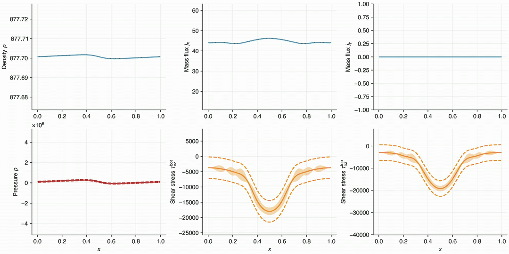

[](https://pypi.org/project/GaPFlow/)
[](https://github.com/hannes-holey/GaPFlow/actions/workflows/test.yaml)
[](https://github.com/hannes-holey/GaPFlow/actions/workflows/test.yaml)
[](https://doi.org/10.21105/joss.09645)

# GaPFlow
*Gap-averaged flow simulations with Gaussian Process regression.*

This code implements the solution of time-dependent lubrication problems as
described in:
- [Holey, H. et al., Tribology Letters 70 (2022)](https://doi.org/10.1007/s11249-022-01576-5)

The extension to atomistic-continuum multiscale simulations with Gaussian
process (GP) surrogate models has been described in:
- [Holey, H. et al., Science Advances 11, eadx4546 (2025)](https://doi.org/10.1126/sciadv.adx4546)

The code uses [µGrid](https://muspectre.github.io/muGrid/) for handling
macroscale fields and [tinygp](https://tinygp.readthedocs.io/en/stable/index.html)
as GP library. Molecular dynamics (MD) simulations run with [LAMMPS](https://docs.lammps.org)
through its [Python interface](https://docs.lammps.org/Python_head.html). Elastic
deformation is computed using [ContactMechanics](https://contactengineering.github.io/ContactMechanics/).

## Installation

`GaPFlow` can be installed via
```
pip install GaPFlow
```
A serial build of LAMMPS is provided for most platforms which allows testing
all of `GaPFlow`'s functionality. For production simulations it is however
recommended to build GaPFlow with parallel LAMMPS on your system.
You need to have MPI installed (e.g. via `apt install openmpi-bin libopenmpi-dev`
on Debian-based systems). To compile for your specific platform, run
```
pip install --no-binary GaPFlow GaPFlow[parallel]
```

You can check your installation by running `gpf_info` from the command line.
```
==========
GaPFlow
==========
Version: ...

==========
LAMMPS
==========
Version: ...
Shared lib: <path-to-your-python-env>/lib/pythonX.Y/site-packages/GaPFlow/_vendor/lammps/liblammps_mpi[.so, .dylib]
MPI: True
mpi4py: True
Packages: ['EXTRA-FIX', 'MANYBODY', 'MOLECULE']

==========
muGrid
==========
Version: ...
NetCDF4: True
MPI: False

==========
PETSc
==========
Version: ...
petsc4py: ...
MUMPS: True
Linear backend (auto): PETSc
```
We currently do not use parallel functionalities of µGrid, so MPI support is not
required. PETSc is optional (see below). Without it, the PETSc section reads
```
Installed: False (install with install_petsc.sh)
Linear backend (auto): SciPy (serial only)
```

For installations from source, do not forget to initialize the LAMMPS submodule after cloning the repository
```
git submodule update --init
```


### Optional: PETSc for 2D FEM solver

The implicit solver requires [PETSc](https://petsc.org/) for MPI-parallel distributed linear algebra. This dependency is **optional**; a [SciPy](https://scipy.org/)-based implementation is provided as an alternative for serial-only execution.

We provide an installation script similar to the LAMMPS installation:
```bash
bash install_petsc.sh
```

This script downloads PETSc, builds it with the required dependencies (BLAS, LAPACK, MUMPS), and installs `petsc4py`. The build takes approximately 15-20 minutes.

After installation, set the environment variables as instructed by the script (or add them to your `~/.bashrc`):
```bash
export PETSC_DIR="$HOME/.local/petsc-3.22.2"
export PETSC_ARCH="arch-linux-c-opt"
```

Verify the installation with `gpf_info` (PETSc section, see above). If PETSc is installed, the implicit solver uses it by default.
To use the SciPy solvers anyway, set `linear_backend: scipy` in the `implicit_solver` section of the input file.

For more details on the PETSc installation (e.g. MPI setup and available linear solvers), run
```bash
python3 .check_petsc.py
```

## Minimal example
Simulation inputs are commonly provided in YAML files. A typical input file
might look like this:

```yaml
# journal.yaml
options:
    output: data/journal
    write_freq: 10
grid:
    dx: 1.e-5
    dy: 1.
    Nx: 100
    Ny: 1
    xE: ['D', 'N', 'N']
    xW: ['D', 'N', 'N']
    yS: ['P', 'P', 'P']
    yN: ['P', 'P', 'P']
    xE_D: 877.7007
    xW_D: 877.7007
geometry:
    type: journal
    CR: 1.e-2
    eps: 0.7
    U: 0.1
    V: 0.
numerics:
    tol: 1e-9
    dt: 1e-10
    max_it: 200
properties:
    shear: 0.0794
    bulk: 0.
    EOS: DH
    P0: 101325
    rho0: 877.7007
    T0: 323.15
    C1: 3.5e10
    C2: 1.23
```

Note that this example uses fixed-form constitutive laws without GP surrogate
models or MD data. More example input files can be found in the [config_lib](config_lib/)
directory.

The input files can be used to start a simulation from the command line
```bash
python -m GaPFlow -i my_input_file.yaml
```
or from a Python script
```python
from GaPFlow.problem import Problem

myProblem = Problem.from_yaml('my_input_file.yaml')
myProblem.run()
```
Simulation output is stored under the location specified in the input file.
After successful completion, you should find the following files.
- `config.yml`: A sanitized version of your simulation input.
- `topo.nc`: NetCDF file containing the gap height and gradients.
- `sol.nc`: NetCDF file containing the solution and stress fields.
- `history.csv`: Contains the time series of scalar quantities (step, Ekin,
  residual, ...)
- `gp_[xz,yz,zz].csv` (Optional): Contains the time series of GP hyperparameters,
  database size, etc.
- `Xtrain.npy` (Optional): Training data inputs
- `Ytrain.npy` (Optional): Training data observations
- `Ytrain_err.npy` (Optional): Training data observation error
- `log.run`: Log file with the solver's per-step status output (also printed to stdout).
- `log.gp` / `log.md` (Optional): Log files for the GP surrogate and MD components, when active.

The code comes with a few handy [command line tools](GaPFlow/cli/) for
visualizations like this one



which shows the transient solution of a 1D journal bearing with active learning
of the constitutive behavior. 

## License

The GaPFlow project is distributed under the terms of the GNU General Public
License version 2 (GPLv2).

The original GaPFlow source files under `GaPFlow/` are licensed under the MIT
License (see `LICENSES/MIT.txt`). This repository also contains third-party
software that is not covered by the MIT License, in particular the LAMMPS
distribution under `lammps/` and Python bindings vendored under
`GaPFlow/_vendor/lammps/`, which are licensed under GPLv2. The full text of
the GPLv2 is included in the `COPYING` file at the repository root.

If you distribute a packaged artifact (for example an sdist or wheel) that
includes the LAMMPS sources or the vendored LAMMPS Python bindings, the
combined distribution is subject to the terms of the GPLv2. In that case,
recipients must be granted the rights required by the GPLv2 and the COPYING
file must be included in distributed artifacts. This does not change the MIT
license that applies to the original GaPFlow sources; rather, when
distributed together with GPLv2-covered files the resulting artifact must
comply with GPLv2.


## Funding
This work received funding from the German Research Foundation (DFG)
through GRK 2450 and from the Alexander von Humboldt Foundation through a
Feodor Lynen Fellowship.
